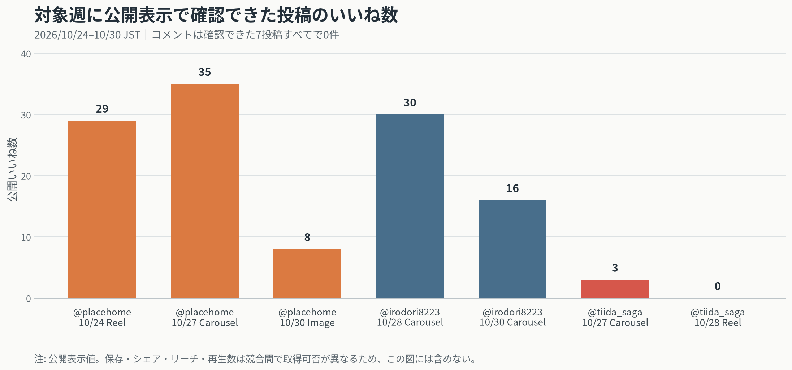

# Instagram競合・自社分析と来週投稿戦略

**分析日**：2026年10月31日
**対象期間**：2026年10月24日 00:00〜10月30日 23:59（JST）
**作成者**：Manus AI

対象9競合のうち、対象週の投稿を公開情報で確認できたのは @placehome の3件と @irodori8223 の2件でした。残る7アカウントは、公開プロフィール・個別投稿ページ・検索結果で対象週の投稿を特定できませんでした。以下の「0件」は、投稿がなかったことの断定ではなく、公開情報から週内投稿を確認できなかったことを表します。保存数、シェア、リーチ、正確な投稿時刻は競合間で取得条件が異なるため、比較の主軸には使いません。

## 競合の直近1週間

| アカウント | 観測フォロワー | 対象週の確認投稿 | 公開反応 | 使用ハッシュタグ・構成上の特徴 |
|---|---:|---|---|---|
| @kicocochi_kobo | 3,020 | 0件。公開一覧で確認できた直近は10/14。 | — | 対象週のタグ・反応は未取得。 [6] |
| @placehome | 3,402 | 3件。10/24 Reel、10/27カルーセル、10/30画像。 | 29、35、8いいね。コメントはいずれも0件。 | 全件で #佐賀注文住宅 #佐賀家づくり。住宅の具体的な特徴、オーナーイベント、外観事例を使い分け。 [7] [8] [9] [10] |
| @eda_kensetsu | 1,430 | 0件。公開一覧で確認できた直近は10/15。 | — | 対象週のタグ・反応は未取得。 [11] |
| @irodori8223 | 770 | 2件。10/28・10/30ともにガレージ付き平屋の施工進捗カルーセル。 | 30、16いいね。コメントはいずれも0件。 | #大牟田市注文住宅 #平屋 #工務店がつくる家 を共通使用。工程と納まりを具体的に説明。 [12] [13] [14] |
| @torikaihome | 2,345 | 0件。公開一覧で確認できた直近は10/22。 | — | 対象週のタグ・反応は未取得。 [15] |
| @inouehousing | 1,046 | 0件。公開一覧で確認できた直近は10/20。 | — | 対象週のタグ・反応は未取得。 [16] |
| @rokka_staff | 476 | 0件。公開一覧で確認できた直近は9/4。 | — | 対象週のタグ・反応は未取得。 [17] |
| @hooop.inc | 1,400 | 0件。公開一覧で確認できた直近は2025/11/27。 | — | 対象週のタグ・反応は未取得。 [18] |
| @eternal_designlife | 599 | 0件。公開一覧で確認できた直近は7/27。 | — | 対象週のタグ・反応は未取得。 [19] |

### 反応が確認できた投稿

@placehome は、10月24日に「1.8m水槽のある平屋LDK」を見せるReelで29いいね、10月27日にオーナー限定のおいもほり体験会を告知するカルーセルで35いいね、10月30日に34坪・2階建てのシンプルモダン住宅の外観画像で8いいねを獲得しました。住宅のスペックや暮らしの情景に加え、既存オーナーとの接点を見せたイベント告知が、この週では最も大きい公開反応でした。 [8] [9] [10]

@irodori8223 は、大牟田市のガレージ付き平屋について、上棟と屋根下地・雨養生という連続した施工進捗を2本のカルーセルで発信しました。30いいねと16いいねで、地域名、住宅タイプ、工程、職人の仕事が一つの投稿内で結び付いています。 [13] [14]

確認できた競合5投稿はすべてコメント0件でした。したがって、いいね数だけを会話や商談意欲の指標と解釈しません。比較可能な公開値だけでは、カルーセルの優位性や各アカウントの投稿頻度の優劣を断定できません。

## 自社アカウント分析：@tiida_saga

@tiida_saga は観測時点でフォロワー566人、投稿319件でした。対象週は2件、いずれも「くらしサポート展」への来場・相談を促す告知でした。 [1]

| 投稿日時（JST） | 形式 | 内容 | 公開反応 | 使用ハッシュタグ |
|---|---|---|---|---|
| 10/27 22:41 | カルーセル | 11/7・8のくらしサポート展を案内。鳥栖で住宅機器、リフォーム、土地探しを相談できることを訴求。 | 3いいね、0コメント | #ティーダ建築工房 #くらしサポート展 #トスプロ #鳥栖市 #みやき町 #家づくり #リフォーム #土地探し [2] |
| 10/28 21:51 | Reel | 同イベントの参加告知。新築、企画住宅、土地探しの相談を訴求。 | 0いいね、0コメント、13再生 | #ティーダ建築工房 #くらしサポート展 #トスプロ #企画住宅 #新築 #みやき町 #鳥栖市 #土地探し [3] |

公開いいね・コメントだけで算出した対象週の平均公開反応率は **0.265%** でした。比較用に同じ式で見ると、@placehome は0.705%、@irodori8223 は2.987%です。フォロワー規模、投稿テーマ、保存・シェア・リーチが揃わないため、数値の上下ではなく改善の出発点として扱います。

今回の2投稿は、同じイベント告知を連日かつ近い時間に出しています。イベント認知には有効ですが、住まいの困りごとを自分ごと化させる情報投稿が不足すると、保存やプロフィール遷移につながりにくくなります。次週は「相談前に確認できる具体的なチェックリスト」を先に置き、イベント投稿をその解決先として接続します。

投稿時刻については、対象週の自社投稿が21:51と22:41、競合5投稿のうちInstagram上で正確な時刻を確認できた投稿がなかったため、最適時間帯は確定できません。次週は **20:30 JST** を仮説の基準時刻に固定し、投稿から24時間・7日後のリーチ、保存、プロフィール遷移、DM数を記録します。時間帯の効果は、同程度の教育コンテンツを昼・夜で比較できるだけのデータが揃ってから判断します。

## 自社アカウント分析：@kazu_ai_terasu

@kazu_ai_terasu は観測時点でフォロワー9人、投稿51件でした。対象週の投稿は1件で、10月27日22:46 JSTの「博多でAIセミナーを行いました」というカルーセルです。建設業DX、住宅資材、サッシを軸に、セミナー相談をDMへ誘導しています。 [4] [5]

この投稿のインサイトは、リーチ2、表示12、いいね0、コメント0、保存0、シェア0、総インタラクション0でした。フォロワーに対するリーチ率は22.222%、表示÷リーチは6.000回です。ただし母数が小さいため、@tiida_saga や住宅系競合との優劣比較には使いません。個人AI活用アカウントでは「住宅資材営業13年の実務」を冒頭で具体化し、資料請求・無料相談など一つのCTAに絞ることを優先します。

## 次週の投稿戦略：11月2日（月）〜11月8日（日）

競合で公開反応が取れた投稿は、「地域名」「住宅の具体的な特徴」「暮らしの情景または施工工程」を一緒に見せていました。ティーダはこれを、単なる完成事例ではなく「相談前に自分で確認できること」に翻訳します。こうすると、地域の見込み客に役立つ保存型コンテンツと、11月7日・8日のイベント相談につながるCTAを一続きにできます。

| 日時（JST） | 形式 | 狙い | 最重要KPI |
|---|---|---|---|
| 11/2（月）20:30 | カルーセル | 玄関の困りごとを整理する保存型投稿で、相談の入口を作る。 | 保存、プロフィール遷移 |
| 11/4（水）20:30 | Reel | くらしサポート展で相談できる内容を短尺で伝え、DMと来場意向を作る。 | リーチ、DM「住まい」 |
| 11/6（金）20:30 | ストーリーズ | 開催前日の想起と、リフォーム・新築の相談ニーズの回収。 | スタンプ回答、DM、リンクまたは地図タップ |

### 1. カルーセル：玄関ドアの相談前に撮る4枚

**投稿日時**：11月2日（月）20:30 JST
**表紙フック**：`玄関ドアの「開けづらい」、相談前にこの4枚を撮ってください`
**目的**：生活上の不便を言語化し、保存とDM相談を増やす。

7枚構成にします。1枚目で困りごとを提示し、2枚目で「全体」、3枚目で「枠・レール・鍵まわり」、4枚目で「床との段差」、5枚目で「扉を開けた状態の通り道」を示します。6枚目では「朝・雨の日・荷物が多い時など、困る場面も一言メモ」と補足し、7枚目で「11/7・8のくらしサポート展でも相談できます。DMは『住まい』」とCTAを置きます。写真だけで施工可否を決めないことも明記し、現地確認の信頼性を守ります。

**キャプションの導入文**：`玄関ドアの相談は、きれいな写真より「どこで困るか」が分かる4枚が役に立ちます。`
**推奨ハッシュタグ**：#ティーダ建築工房 #佐賀リフォーム #鳥栖市リフォーム #みやき町リフォーム #玄関リフォーム #玄関ドア #住まいの相談 #リフォーム相談 #暮らしの動線 #家づくり #佐賀家づくり #佐賀の工務店 #鳥栖市 #みやき町 #土地探し

### 2. Reel：くらしサポート展で相談できる3つ

**投稿日時**：11月4日（水）20:30 JST
**冒頭2秒のフック**：`鳥栖で、家づくりやリフォームを相談するなら`
**目的**：イベントを「行ってみよう」ではなく、「自分の相談を持って行こう」と感じてもらう。

20〜25秒に収めます。0〜2秒は会場・日付の文字表示、3〜14秒は「住宅機器を見て触れる」「リフォームの困りごとを話せる」「企画住宅・土地探しを相談できる」の3項目を、1項目3〜4秒ずつ紹介します。15〜20秒は開催情報、最後は `DMで「住まい」と送ると、相談内容を事前に整理できます` と表示します。会場や分譲地の写真ではない素材は、必ず説明用ビジュアルであることを画面とキャプションで明示します。

**キャプションの導入文**：`「何から相談したらいいか分からない」方へ。会場で聞けることを3つに絞りました。`
**推奨ハッシュタグ**：#ティーダ建築工房 #くらしサポート展 #トスプロ #鳥栖市 #みやき町 #佐賀リフォーム #佐賀注文住宅 #家づくり相談 #土地探し #企画住宅 #新築 #リフォーム相談 #佐賀の工務店 #鳥栖市イベント #住宅設備

### 3. ストーリーズ：開催前日の相談ニーズ回収

**投稿日時**：11月6日（金）20:30 JST
**目的**：翌日のイベントを思い出してもらい、来場前の不安をDMに変える。

4枚で構成します。1枚目は `明日・明後日は鳥栖でくらしサポート展` と開催日・会場を表示します。2枚目は質問スタンプで `今、住まいで気になるのは？` と問い、選択肢を「リフォーム」「新築・土地」「住宅設備」にします。3枚目は回答に関係なく使える `写真やメモがなくても大丈夫。困る場面を一言教えてください` を表示します。4枚目は会場・時間・駐車場あり・DMキーワード「住まい」を再掲し、位置情報スタンプに鳥栖市を設定します。

## 実行時の確認項目

投稿ごとに、公開後24時間と7日後のリーチ、再生数、いいね、保存、シェア、プロフィール遷移、フォロー、DM数を同じシートへ記録します。カルーセルは保存数、Reelはリーチと3秒時点の視聴維持、ストーリーズは質問スタンプ回答とDM数を主指標にします。特に「DMに『住まい』」というキーワードの件数を、投稿別に分けて記録してください。次週は、イベント告知とチェックリスト投稿のどちらが相談行動に寄与したかを、いいね数ではなく保存・DM・プロフィール遷移で比較します。

## References

[1]: https://www.instagram.com/tiida_saga/ "@tiida_saga Instagram profile"
[2]: https://www.instagram.com/p/De_-u1_ILzH/ "@tiida_saga くらしサポート展カルーセル"
[3]: https://www.instagram.com/reel/DfCeQraEqea/ "@tiida_saga くらしサポート展Reel"
[4]: https://www.instagram.com/kazu_ai_terasu/ "@kazu_ai_terasu Instagram profile"
[5]: https://www.instagram.com/p/De__1XtFQH2/ "@kazu_ai_terasu 博多AIセミナーカルーセル"
[6]: https://www.instagram.com/kicocochi_kobo/ "@kicocochi_kobo Instagram profile"
[7]: https://www.instagram.com/placehome/ "@placehome Instagram profile"
[8]: https://www.instagram.com/placehome/reel/De3_rviTk1t/ "@placehome 水槽のある平屋LDK Reel"
[9]: https://www.instagram.com/placehome/p/De_kRV7EzxR/ "@placehome オーナーイベントカルーセル"
[10]: https://www.instagram.com/placehome/p/DfHJz75kzSU/ "@placehome 34坪2階建て住宅投稿"
[11]: https://www.instagram.com/eda_kensetsu/ "@eda_kensetsu Instagram profile"
[12]: https://www.instagram.com/irodori8223/ "@irodori8223 Instagram profile"
[13]: https://www.instagram.com/p/DfCCqaDE2y5/ "@irodori8223 ガレージ付き平屋上棟投稿"
[14]: https://www.instagram.com/p/DfHP8rIE9U8/ "@irodori8223 ガレージ付き平屋屋根施工投稿"
[15]: https://www.instagram.com/torikaihome/ "@torikaihome Instagram profile"
[16]: https://www.instagram.com/inouehousing/ "@inouehousing Instagram profile"
[17]: https://www.instagram.com/rokka_staff/ "@rokka_staff Instagram profile"
[18]: https://www.instagram.com/hooop.inc/ "@hooop.inc Instagram profile"
[19]: https://www.instagram.com/eternal_designlife/ "@eternal_designlife Instagram profile"
