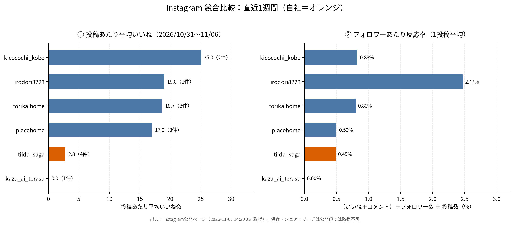

# Instagram競合・自社分析と来週投稿戦略

**分析日**：2026年11月7日（土）
**対象期間**：2026年10月31日（土）00:00〜11月6日（金）23:59（JST）
**対象**：競合9アカウント／自社2アカウント（@tiida_saga、@kazu_ai_terasu）
**作成**：Manus AI

---

## 0. 3行サマリー

1. 直近1週間で投稿があった競合は9アカウント中**4アカウント・計9投稿**。@eda_kensetsu、@rokka_staff、@hooop.inc、@eternal_designlife は週内の新規投稿が確認できなかった。
2. 反応が取れた投稿に共通するのは**「1投稿＝1つの具体的な部位」＋「地名」＋「暮らしの情景」**の三点セット。平均いいねは @kicocochi_kobo 25.0、@irodori8223 19.0、@torikaihome 18.7、@placehome 17.0 に対し、@tiida_saga は **2.75**。
3. 自社は週4投稿で**投稿本数は5アカウント中最多**だが、1投稿あたりの作り込みが最も薄い。来週は「本数を維持しつつ、抽象語を消して具体部位×地名×実写真に置き換える」ことを最優先にする。

---

## 1. 計測方法と制約（先に読む）

- 数値はすべて **Instagram公開ページ（ログアウト状態）** から2026年11月7日14:20 JSTに取得した公開値。プロフィールのフォロワー数、投稿ページのいいね数・コメント数、キャプション、ハッシュタグが対象。
- **取得できない指標**：保存数、シェア数、リーチ、再生数、プロフィール遷移、正確な投稿時刻。このため本レポートでは、いいね数とコメント数だけで比較し、それ以上の意味づけはしない。
- Instagram連携（ビジネスアカウントのインサイト取得）は**今週は未接続**だったため、@tiida_saga のリーチ・保存数は本レポートに含まれない。来週の検証設計（第8章）で「自社インサイトを必ず突き合わせる」前提を置いている。
- 週内0件のアカウントは「投稿がなかった」と断定せず、**「公開一覧で週内の新規投稿を確認できなかった」**と記載する。

---

## 2. 競合の直近1週間

| アカウント | フォロワー | 週内投稿 | 平均いいね | 平均コメント | 反応率（1投稿平均） | 主なハッシュタグ |
|---|---:|---:|---:|---:|---:|---|
| @kicocochi_kobo | 3,022 | 2件（11/3・11/6） | **25.0** | 0.0 | 0.83% | #木ここち建築工房 #八女市星野村の工務店 #庭と一体の暮らし #星野村 |
| @irodori8223 | 770 | 1件（11/3） | 19.0 | 0.0 | **2.47%** | #ルイスポールセン #パテラ #ldk #薪ストーブのある暮らし #ダイニング |
| @torikaihome | 2,341 | 3件（11/1・11/3・11/5） | 18.7 | 0.0 | 0.80% | #トリカイホーム #佐賀注文住宅 #玄関ポーチ #植栽のある暮らし #外構照明 |
| @placehome | 3,401 | 3件（10/31・11/4・11/6） | 17.0 | 0.0 | 0.50% | #佐賀注文住宅 #佐賀家づくり + 部位タグ3つ |
| @eda_kensetsu | 1,414 | 0件（直近9/3） | — | — | — | — |
| @rokka_staff | 477 | 0件（直近10/26） | — | — | — | — |
| @hooop.inc | 1,397 | 0件（直近2025/11/27） | — | — | — | — |
| @eternal_designlife | 602 | 0件（直近7/27） | — | — | — | — |

**反応率の定義**：（いいね＋コメント）÷フォロワー数÷投稿数×100。フォロワー規模が違うアカウントを並べるための補正値で、優劣の断定には使わない。

### 投稿一覧（週内・全9件）

| 日付 | アカウント | 形式 | 内容（冒頭フック） | いいね | コメント |
|---|---|---|---:|---:|---:|
| 10/31 | @placehome | 画像 | 黒と木目調が織りなす、上質で心地よい住まい。シンプルモダン【2階建】約34坪 | 23 | 0 |
| 11/01 | @torikaihome | 画像 | 曲線の奥に、小さな居場所（階段上の造作カウンター） | 22 | 0 |
| 11/03 | @kicocochi_kobo | 画像 | 雨の日にも、楽しみを。（鎖樋からビオトープへ流れる雨水） | **29** | 0 |
| 11/03 | @irodori8223 | 画像 | ルイスポールセン パテラ（斜め下45度の照明） | 19 | 0 |
| 11/03 | @torikaihome | 画像 | 家に入る前から、心地よく（玄関ポーチの軒天と外構照明） | 24 | 0 |
| 11/04 | @placehome | 画像 | 黒と木目調が織りなす、上質で心地よい住まい。シンプルモダン【2階建】約34坪 | 13 | 0 |
| 11/05 | @torikaihome | 画像 | 買い物帰りも、仕事を終えた日も（玄関アプローチの植栽） | 10 | 0 |
| 11/06 | @kicocochi_kobo | 画像 | 外で過ごす時間を、もっと。（ピザ窯と砂場のある庭） | 21 | 0 |
| 11/06 | @placehome | 画像 | 完成見学会のお知らせ📢 Rの曲線が美しいオーガニックモダンな【平屋】 | 15 | 0 |

**9投稿すべてコメント0件。** 建築系の地域アカウントでは、コメントはそもそも発生しにくい。したがって「コメントが少ない＝関心が低い」とは読まず、**保存・プロフィール遷移・DM**を主指標に据えるのが妥当（第8章）。

---

## 3. 反応が取れた投稿の構成分解

「何を書いたか」より「どの順番で見せたか」に差が出ていた。上位3投稿を分解する。

### 3-1. @kicocochi_kobo 11/3（29いいね・週内最高）

1. **1行目で季節と感情**：「雨の日にも、楽しみを。」
2. **部位を一つだけ名指し**：軒先の**鎖樋**→**ビオトープ**へ流れる雨水。設計意図は「排水を庭の風景に変えた」の一点。
3. **五感の描写**：水面の波紋、泳ぐ小魚、しゃがいて覗く、雨音に耳を澄ます。写真を見た後に「自分がそこにいる」想象をさせる。
4. **場所の固定**：【八女市星野村】ショールームやどり木。見学可能な実在の場に接続。
5. **タグは4つだけ**（ブランド／地域／世界観／地名）。

**構造上の要点**：情報量は多いが、主張は「雨水を庭の一部にした」の1つだけ。読み終わった後に残る印象が単数なので、保存されやすい。

### 3-2. @torikaihome 11/3（24いいね）

1. **時間帯の情景**：「出かける朝も、帰ってくる夕方も。一日に何度も通る玄関。」
2. **納まりの説明**：軒下の天井とドアに木目を合わせ、そばに植栽。
3. **夜の表情**：日が暮れると天井の灯りが玄関を照らし、庭の灯りが枝葉を映す。
4. **CTA は控えめ**：「毎月イベント開催中／詳細はプロフィールのリンク」。
5. **タグ5つ**（ブランド／地域／部位2つ／世界観）。

**構造上の要点**：朝・夕・夜と**時間軸で1つの場所を3回見せる**。同じ玄関でも情報が重複しない。11/1の「階段上のカウンター」、11/5の「アプローチ」と合わせ、**3投稿が同じ「玄関〜アプローチ」という一つの物語の連作**になっている。週単位で見ると、単発ではなく連載として設計されている。

### 3-3. @placehome 11/6（15いいね・イベント告知）

1. **告知を1行目に置く**：「完成見学会のお知らせ📢」
2. **物件の短い説明**：Rの曲線、オーガニックモダンな平屋、完全予約制、11/14〜15。
3. **見どころ3点**：手書きニッチが3つ並ぶ廊下／カフェのようなキッチン／造作風洗面。**「行ったら何が見られるか」を箇条書き**。
4. **会社の定型ブロック**（特徴5項目・営業時間）。
5. **タグ5つ**。

**構造上の要点**：イベント投稿でも「見どころ3点」を必ず入れている。告知単独の投稿は週内で1本もなく、**すべての投稿が「事例 or 見どころ」を主役にしている**。

---

## 4. ハッシュタグの実態

| アカウント | 1投稿あたりのタグ数 | 構成パターン |
|---|---:|---|
| @kicocochi_kobo | 4 | ブランド＋「八女市星野村の工務店」＋世界観＋地名（**全投稿で完全固定**） |
| @torikaihome | 5 | ブランド＋#佐賀注文住宅＋部位タグ2つ＋世界観 |
| @placehome | 5 | #佐賀注文住宅 #佐賀家づくり（固定）＋部位タグ3つ（投稿ごとに変更） |
| @irodori8223 | 5 | 商品名・部位タグ中心（地域タグなし） |
| @tiida_saga（自社） | 4〜10 | 投稿ごとに構成がばらばら。11/6は「#美ゅら家uluサンゴの塗り壁」で1タグだが、11/3は「#美ゅら家」と「uluサンゴの塗り壁」の間が半角スペースで切れており、**タグとして機能していない** |

**観測事実**：反応が取れている4アカウントは、そろって**4〜5個**しかタグを使っていない。一方で、地域タグ（#佐賀注文住宅 等）は4アカウント中3アカウントが**全投稿で固定**して使っている。「タグを増やす」より「**固定タグを毎回同じ表記で積む**」方が、アカウントの主题（何の会社か）をアルゴリズムとユーザーの双方に伝えやすい。

自社は10個付けている投稿が2本あるが、反応は3いいね・1いいね。**タグ数は反応の説明変数になっていない**。むしろ表記ゆれでタグが分散している点を先に直す。

---

## 5. 投稿時間帯の分析

公開ページの相対表示（「◯時間前」）と投稿日から、直近投稿の**推定**時刻を出した。

| アカウント | 直近投稿の推定時刻（JST） | 根拠 |
|---|---|---|
| @kicocochi_kobo | 11/6 18時台 | 取得時刻14:20に対し「20時間前」 |
| @placehome | 11/6 19時台 | 「19時間前」 |
| @tiida_saga（自社） | 11/6 18〜19時台 | 「18〜19時間前」 |
| @torikaihome | 11/5 日中〜夕方 | 「1日前」（粒度が粗く特定不可） |

**結論**：主要競合と自社の投稿時間帯は**ほぼ同じ（18〜19時台）**。時間帯の差は反応差の説明にならない。現時点で「最適時間帯」を断定できるデータはないため、**来週は19:30固定で4本、うち1本だけ12:15に置いて同一テーマで比較する**（第8章）。時間帯の結論は、この比較が終わってから出す。

---

## 6. 自社アカウント分析

### 6-1. @tiida_saga

**フォロワー566／フォロー1,633。プロフィール名は「🪸サンゴのぬり壁の家｜美ゅら家ulu 🏠」に変更済み**（前週までは「（株）ティーダ建築工房」）。ブランドの主語が「サンゴの塗り壁」に移っている。

| 日付 | 形式 | 内容 | いいね | コメント | タグ数 |
|---|---|---|---:|---:|---:|
| 11/02 | カルーセル | 玄関ドアが開けづらいときに相談前に確認する4つ | 3 | 0 | 10 |
| 11/03 | 画像 | 洗練の外観✨ | 5 | 0 | 5 |
| 11/05 | リール | くらしサポート展の参加告知（11/7・8） | 1 | 0 | 10 |
| 11/06 | 画像 | リゾートな暮らし🏝 | 2 | 0 | 4 |

- 合計11いいね／平均2.75／反応率0.49%。**投稿本数4本は5アカウント中最多**、反応は最少。
- 4投稿すべてで、投稿ページに**AI生成コンテンツであることを示す表示**が確認された（11/2はキャプションにも「説明用の生成画像」と明記）。競合4アカウントの週内9投稿にはこの表示がない（＝実写真）。
- 11/2のカルーセルは前週提案の「玄関ドア4枚チェック」を実行したもの。内容は具体的だが、**冒頭の1行目が「玄関ドアの『開けづらい』。相談するとき、どんなことを伝えればいいか迷いませんか？」**と状況説明から入っており、競合の「雨の日にも、楽しみを。」のような**感情の1行**になっていない。
- 11/6「リゾートな暮らし🏝」は、**本文が1行＋定型のブランドブロックのみ**。何の家か、どこか、誰向けかが本文に一切ない。週内で最も情報密度が低い投稿であり、2いいねという結果は妥当。

**構造上の最大の問題**：キャプションの冒頭が「🏠 美ゅら家uluサンゴの塗り壁の家（ティーダ建築工房）／🌿 サンゴのぬりかべが得意な佐賀の工務店／💡 新築・リフォーム…」という**会社紹介ブロックから始まる投稿がある**こと。1行目は検索結果とフィードで最初に見える場所であり、そこで会社名を名乗っても読む理由にならない。競合4社は1行目をすべて**情景かベネフィット**に使っている。

### 6-2. @kazu_ai_terasu

フォロワー9／投稿51件。週内は11/4の1件「【日報の下書き、音声メモから】」。いいね0・コメント0。

内容は実務的で、コピペできるプロンプトを本文に置き、最後に「保存しておいてください」と保存CTAを置いている。**構成としては競合の保存型投稿に近い**。ただしフォロワー9人では拡散の母数がなく、現状は「アーカイブとしての価値」に留まる。伸ばすなら、住宅資材営業13年の一次情報（例：現場で実際に使われている日報の項目）を前面に出す方向が有望。来週の主戦場は @tiida_saga に置く。

---

## 7. 来週の投稿戦略（11月9日〜11月15日）

### 7-1. 戦略の核

競合の勝ち筋は「抽象的な世界観」ではなく、**具体名詞の密度**だった。鎖樋、ビオトープ、軒天、外構照明、造作カウンター、垂れ壁、ハイドア——すべて**図面や見積りに出てくる言葉**であり、検討初期のユーザーが検索・保存する語でもある。自社は今週「洗練」「リゾート」という**形容詞**で戦っていた。来週はここを反転させる。

1. **1投稿＝1部位**。タイトルに部位名を必ず入れる（例：「サンゴの塗り壁」「玄関の土間」「洗面の下地」）。
2. **地名を本文に書く**。タグだけでなく「みやき町」「鳥栖市」「基山町」を本文中に1回以上入れる。
3. **実写真に戻す**。AI生成画像は「説明用」と明示する場合を除き使わない。11/7・8のくらしサポート展で撮った写真が最優先素材。
4. **1行目は感情か数字**。会社紹介ブロックは末尾へ移動。
5. **固定タグを整える**：#ティーダ建築工房 #佐賀注文住宅 #佐賀リフォーム #美ゅら家uluサンゴの塗り壁 の4つを全投稿で同一表記、＋部位タグ2〜3。

### 7-2. 週間スケジュール

| 日時（JST） | 形式 | テーマ | 狙い | 最重要KPI |
|---|---|---|---|---|
| 11/9（月）19:30 | カルーセル | くらしサポート展・2日間の相談ベスト3 | イベントの実績を「次の相談」に変換 | 保存、プロフィール遷移 |
| 11/11（水）12:15 | リール | サンゴの塗り壁を手で触るとどうなるか | 独自素材の体験価値を伝える | 再生数、3秒維持率 |
| 11/13（金）19:30 | リール | 玄関土間、失敗しない寸法の見方 | 検討初期の検索需要を拾う | リーチ、保存 |
| 11/14（土）19:30 | 画像／カルーセル | ビフォーアフター（同アングル2枚） | 施工力の証明 | 保存、コメント |
| 11/15（日）12:15 | ストーリーズ | 質問スタンプ「家づくりで一番迷ったのは？」 | 相談ニーズの回収 | スタンプ回答、DM |

投稿案の詳細（キャプション全文・スライド構成・リール台本・ストーリーズ構成）は [proposals/posts_20261109_20261115.md](../proposals/posts_20261109_20261115.md) に分離した。

### 7-3. なぜこの5本か

- **月曜カルーセル**：競合は「見どころ3点」を告知に入れていた。自社はイベント後の**実際の相談内容**を持っている。これは競合が持っていない一次情報で、保存とプロフィール遷移に直結する。
- **水曜リール（12:15）**：今週の検証で「時間帯の差は内容の差に比べて小さい」と分かった。だから水曜だけ**昼12:15**に置き、夜投稿との比較データを意図的に作る。テーマは自社だけの素材（サンゴの塗り壁）。
- **金曜リール（19:30）**：検索されやすい「寸法」を扱う。競合4社の週内9投稿に寸法・数字を扱ったものは0件で、空白地帯。
- **土曜ビフォーアフター**：競合の週内投稿は完成写真のみ。工程写真を持つのは工務店の強み。
- **日曜ストーリーズ**：フィード投稿で拾えなかった「迷い」を質問スタンプで回収し、翌週のカルーセルの素材にする。

---

## 8. 検証設計（来週の測定）

投稿ごとに、公開後24時間と7日後の以下を1枚のシートに記録する。**いいね数は主指標にしない**。

| 指標 | カルーセル | リール | ストーリーズ |
|---|---|---|---|
| リーチ | ○ | ◎ | ○ |
| 保存 | ◎ | ○ | — |
| シェア | ○ | ◎ | ○ |
| 3秒時点の視聴維持 | — | ◎ | — |
| プロフィール遷移 | ◎ | ○ | ○ |
| スタンプ回答／DM件数 | ○ | ○ | ◎ |

**今週の仮説**：「具体部位＋地名＋実写真」に置き換えた投稿は、平均いいねが2.75から**5以上**（フォロワー比0.9%以上）に上がる。水曜12:15と夜19:30の比較で、リールの再生数に20%以上の差が出れば時間帯効果ありと判断する。

**注意**：Instagram連携が未接続のため、リーチ・保存は現時点で取得できていない。投稿前に連携を復旧させること。取得できないままでは、本レポートの仮説は「いいね数」でしか検証できず、判断を誤る。

---

## 9. リスクと注意点

- **AI生成画像の扱い**：今週の4投稿すべてにAI生成に関する表示が付いていた。住宅は「実際に建つもの」を買う商材であり、生成画像が実物と誤認されると信頼を損なう。使う場合は「説明用の生成画像です」を本文と画面の両方に明記する（11/2の投稿は明記できており、この点は適切）。
- **フォロー数の非対称**：@tiida_saga はフォロー1,633／フォロワー566。フォローバック目的の運用に見えやすく、フォロワーの質が上がりにくい。新規フォローは週20件程度に抑え、**保存される投稿で増やす**方向へ比重を移す。
- **アカウント名の変更**：プロフィール名が「美ゅら家ulu」主体に変わったことで、「ティーダ建築工房」での認知と分断される可能性がある。プロフィール文には社名を残し、投稿の固定タグに #ティーダ建築工房 を必ず入れて接続を保つ。
- **0件アカウントの扱い**：@hooop.inc は1年間更新が止まっている。競合として監視を続ける優先度は下げ、代わりに新規競合（佐賀・福岡の工務店で週2本以上投稿しているアカウント）の追加を検討する。

---

## 10. 付録：使用データ

- 生データ：[reports/data_20261107.json](data_20261107.json)（アカウント・投稿・いいね・タグ・取得時刻）
- グラフ生成：[scripts/make_analysis_chart.py](../scripts/make_analysis_chart.py)
- データ定義：[scripts/build_report_data.py](../scripts/build_report_data.py)

## References

[1]: https://www.instagram.com/tiida_saga/ "@tiida_saga プロフィール"
[2]: https://www.instagram.com/tiida_saga/p/DfO_KzhFXJX/ "@tiida_saga 玄関ドア4つのチェック（11/2）"
[3]: https://www.instagram.com/tiida_saga/p/DfRngFJFKmv/ "@tiida_saga 洗練の外観（11/3）"
[4]: https://www.instagram.com/tiida_saga/reel/DfXJkQeAcZ5/ "@tiida_saga くらしサポート展リール（11/5）"
[5]: https://www.instagram.com/tiida_saga/p/DfZV4lWjVrp/ "@tiida_saga リゾートな暮らし（11/6）"
[6]: https://www.instagram.com/kazu_ai_terasu/p/DfUZc-FlawD/ "@kazu_ai_terasu 日報の下書き（11/4）"
[7]: https://www.instagram.com/kicocochi_kobo/ "@kicocochi_kobo プロフィール"
[8]: https://www.instagram.com/kicocochi_kobo/p/DfTsPI1msfi/ "@kicocochi_kobo 鎖樋とビオトープ（11/3）"
[9]: https://www.instagram.com/kicocochi_kobo/p/DfZLVx7mvaM/ "@kicocochi_kobo ピザ窯のある庭（11/6）"
[10]: https://www.instagram.com/placehome/ "@placehome プロフィール"
[11]: https://www.instagram.com/placehome/p/DfJu6Irk3pM/ "@placehome 34坪2階建て（10/31）"
[12]: https://www.instagram.com/placehome/p/DfUCF2mk5Uv/ "@placehome 34坪2階建て（11/4）"
[13]: https://www.instagram.com/placehome/p/DfZS-8xk-Ll/ "@placehome 完成見学会告知（11/6）"
[14]: https://www.instagram.com/eda_kensetsu/ "@eda_kensetsu プロフィール"
[15]: https://www.instagram.com/irodori8223/ "@irodori8223 プロフィール"
[16]: https://www.instagram.com/irodori8223/p/DfRv-_rkwfG/ "@irodori8223 ルイスポールセン パテラ（11/3）"
[17]: https://www.instagram.com/torikaihome/ "@torikaihome プロフィール"
[18]: https://www.instagram.com/torikaihome/p/DfD_iFVkf-Y/ "@torikaihome 階段上の造作カウンター（11/1）"
[19]: https://www.instagram.com/torikaihome/p/DfD_jJ3EeHE/ "@torikaihome 玄関ポーチと外構照明（11/3）"
[20]: https://www.instagram.com/torikaihome/p/DfYl4mnE8GO/ "@torikaihome 玄関アプローチの植栽（11/5）"
[21]: https://www.instagram.com/rokka_staff/ "@rokka_staff プロフィール"
[22]: https://www.instagram.com/hooop.inc/ "@hooop.inc プロフィール"
[23]: https://www.instagram.com/eternal_designlife/ "@eternal_designlife プロフィール"
